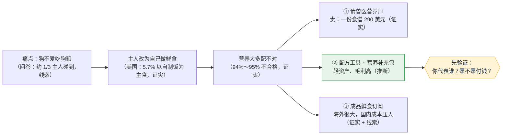

# 市场调研（阶段 A 预调研）：狗不爱吃狗粮，主人自己做鲜食却不会配营养

- 日期：2026-11-04 · 角色：市场经理（调研） · 依据 agents main `e06426e`
- **状态说明**：这个题目还**不是在跑的项目**。按 C146，新业务线要 Amos 发启动命令（L3），所以没有在 agents 里建 `项目/` 文件夹。这份报告先放在 Pet 仓库的分支 `claude/pet-dog-nutrition-research-an0ird` 里的 `research/` 文件夹，Amos 发了启动命令后再搬进 `agents/项目/<代号>/调研/`。
- **采集范围**：英文资料 8 次网页搜索（美国问卷、兽医研究、海外公司、价格），中文资料 4 次（中国市场规模、渗透率、品牌）；**打开原文核对了 9 个页面**（下表里标「证实」的都打开过）；另有 4 个页面打不开（AAHA 403、Balance It 503 和 429），对应条目降为「线索」。没做用户访谈，也没有中国自制鲜食人群比例的原始数据。
- 标注口径（C66）：**证实** = 我打开过原文，数字一致；**线索** = 只在搜索摘要或二手转述里看到，或者是公司自己出钱做的问卷；**推断** = 我按写明的假设算出来的。

## 一图看懂

**一句话结论**：痛点是真的（证实），市场也是真的（海外有两家 10 亿美元级的公司，证实）。但最值得做的切入点**不是卖鲜食，而是帮自己做饭的人把营养配对**（推断）。这条路的收入量级大约是**每年几百万到几千万元人民币**（推断，假设见第五节），前提是付费意愿能被验证，而这一点**现在还没有任何数据**。

---

## 一、这个问题普遍吗

| 结论 | 看到的（出处） | 标注 |
|---|---|---|
| 美国约 5.7% 的狗以自制饭为主食 | Dog Aging Project，40,307 只狗：自制熟食 1,670 只（4%）、自制生食 630 只（2%），合计 2,300 只。[数据页](https://data.dogagingproject.org/HlesDiet?year=2024) | **证实** |
| 另有约 8.8% 的狗把自制饭当辅食 | 同一数据页：有辅食的 14,036 只里，自制熟食 2,955 只、自制生食 587 只，合计 3,542 只，占全部狗的 8.8% | **证实**（比例是我按原始数字算的） |
| → 美国大约每 7 只狗里就有 1 只日常吃自制饭 | 上面两项相加约 14.5% | 推断 |
| 约 1/3 的主人说狗挑食 | 各家问卷：37%（Butternut Box 2023）、35%（OnePoll / Zignature）、43%（Loops/Yummypets 2025）、32%（Talker / Darwin's）、49% 说很难让狗吃完。[Yahoo](https://uk.news.yahoo.com/socks-childrens-toys-34-dog-150100755.html)、[Global Pet Industry](https://globalpetindustry.com/news/data-pet-food-toppers-are-gaining-popularity-especially-among-picky-eaters/)、[CBS](https://cbsnews.com/minnesota/news/dogs-considered-pickier-eaters-than-kids-survey-finds)、[inkl](https://www.inkl.com/news/picky-eaters-how-respondents-are-getting-their-pets-to-eat-their-food) | **线索**（全是公司出钱做的问卷，而且我没有逐份打开原文） |
| 中国 90 后宠主里 41.2% 把鲜食纳入日常喂养 | 澎湃新闻转述《2025 中国宠物行业白皮书》，比 2023 年提高 27 个百分点；原文没写样本和调查方法。[澎湃](https://www.thepaper.cn/newsDetail_forward_31832416) | **线索**（打开了转述的文章，但没找到白皮书原文；这里的“鲜食”也包括买的成品） |
| 2024 年淘天狗粮“生骨肉”销量同比增长 76% | 同上，澎湃转述《2025 淘宝天猫狗品类趋势洞察》 | 线索 |
| 中国城镇宠物狗约 5,258 万只（2024 年） | 研报转述白皮书。[东方财富研报](https://pdf.dfcfw.com/pdf/H3_AP202508211731540267_1.pdf) | 线索（没打开研报原文） |
| 中国自己做狗饭的人有多少 | 没查到 | **未查到** |

**我们的判断**：狗挑食、主人自己做饭，在美国是**有扎实数据的普遍现象**。在中国，有趋势信号（鲜食和生骨肉在增长），但**自己做饭的人到底有多少，没有数据**。这是第一个要补的缺口。

## 二、自己做鲜食，营养问题有多严重

| 结论 | 看到的（出处） | 标注 |
|---|---|---|
| 主人自己做的狗饭，最多只有 6% 可能营养齐全 | Dog Aging Project：分析了 1,726 份自制狗饭（2023 年的问卷），按 AAFCO 成犬标准只有 6% “可能齐全”；另有 45% 的主人会往里加商品粮或拌料。发表于 *American Journal of Veterinary Research*，2025。[DAP 结果页](https://content.dogagingproject.org/scientific-results-findings-from-the-dog-aging-project-home-prepared-diets-for-companion-dogs-feature-diverse-ingredients-and-few-are-nutritionally-complete/) | **证实** |
| 网上和书上的狗饭食谱，95% 至少缺一种必需营养素 | UC Davis 2013：分析了来自 34 个出处的 200 份食谱，95% 至少缺一种，83% 以上同时缺好几种，92% 写得含糊；只有 4 份出自持证兽医营养师，这 4 份全部合格。[UC Davis 新闻稿 PDF](https://ccah.vetmed.ucdavis.edu/sites/g/files/dgvnsk4586/files/local_resources/pdfs/Homemade_dog_food_recipes_July-15-2013_UCD-News.pdf) | **证实** |
| 最常缺的是钙、锌、维生素 D/E、胆碱、Omega-3 | 兽医综述和行业媒体。[Royal Canin Vet Focus](https://vetfocus.royalcanin.com/en/scientific/homemade-diets-good-or-bad)、[dvm360](https://www.dvm360.com/view/study-finds-homemade-diets-for-canines-often-lack-key-nutrients) | 线索（没逐篇打开核对） |

**我们的判断**：真正的痛点不是“不会做饭”，而是**“做了也不知道营养够不够”**。主人自己看不出来（狗照样吃得香），问题要几个月甚至几年才会显现。

## 三、现在有哪些解决办法（竞品）

| 办法 | 代表 | 价格 | 标注 | 我们的判断 |
|---|---|---|---|---|
| 请兽医营养师出食谱 | Cornell 大学兽医院 | 咨询 50～100 美元；出一份自制食谱 290 美元（含 3 个月跟进）。[Cornell 表格 PDF](https://www.vet.cornell.edu/sites/default/files/Nut%20Consult%20Form.pdf) | **证实** | 最可靠，但贵；中国持证营养师很少（未查到具体人数） |
| 配方软件 + 补充剂 | Balance It（软件免费，靠卖补充剂赚钱）；PetDiets（软件第一份食谱 25 美元，之后每份 12 美元） | [Balance It](https://www.balance.it/faqs)（503，没打开）、[PetDiets](https://www.petdiets.com/Ask-the-Nutritionist?Page=2) | 线索 | **这是最值得借鉴的模式**：工具免费引流，补充剂长期复购 |
| 成品鲜食订阅 | The Farmer's Dog、Freshpet；国内有鲜朗、弗列加特等 | 国内电商成品鲜食普遍约 15 元/100 克（澎湃） | 线索 | 小型犬每天约 300 克，折合约 45 元/天、1.6 万元/年（推断），远高于每只狗每年平均 2,961 元的总花费（线索），**价格门槛很高** |
| 拌料 / 拌饭 | 各类 topper、冻干 | — | — | 能解决挑食，营养底子还是靠狗粮 |

## 四、海外有没有人靠这个赚到钱

| 结论 | 看到的（出处） | 标注 |
|---|---|---|
| Freshpet 2025 年净销售额 11.02 亿美元，同比增长 13%，毛利率 40.8%；2026 年预计增长 7%～10% | [Freshpet 2025 全年财报](https://freshpet.gcs-web.com/news-releases/news-release-details/freshpet-inc-reports-fourth-quarter-and-full-year-2025-financial) | **证实** |
| The Farmer's Dog 2024 年年化净收入约 12 亿美元 | Contrary Research 写的是**估算**，不是公司披露；页面上**没有提到盈利**。[Contrary](https://contrary-research.vercel.app/company/the-farmers-dog) | **线索**（我打开过，但它本身只是估算） |
| 全球鲜食市场规模在 16.5 亿到 138 亿美元之间 | 各家研究公司口径差别很大。[MarketResearch](https://www.marketresearch.com/APO-Research-Inc-v4273/Global-Fresh-Pet-Food-Outlook-42846774)、[Technavio](https://technavio.com/report/fresh-pet-food-market-in-us-industry-analysis) | 线索 |

## 五、在中国能赚多少

### 5.1 做成品鲜食（不建议我们做）
| 结论 | 看到的（出处） | 标注 |
|---|---|---|
| 鲜食只占约 3,000 亿元宠物食品市场的 5% | 蓝鲸新闻（3,000 亿这个数原文没写来源）。[蓝鲸](https://www.lanjinger.com/d/1755164992095763093) | 线索（打开过；这里的 5% 是**市场份额**，不是喂养渗透率，**美国 36% 的说法在原文里没找到，已删掉**） |
| 宠物鲜食市场 2027 年预计达到 240 亿元 | 蓝鲸转述《2025 年中国宠物行业白皮书》 | 线索 |
| 成本主要在供应链；保质期短，损耗高 | 蓝鲸原文 | 线索（作者自己的分析，不是企业数据） |
| 鲜食毛利率普遍 60%～70% | 澎湃原文 | 线索（没给出处） |
| 很多商家光靠卖鲜食赚不到稳定的钱，转去卖零食 | [界面新闻](https://www.jiemian.com/article/12536761.html) | 线索（没打开原文） |

**我们的判断**：冷链、工厂、损耗都是重资产的事。我们前期不花钱（底线 8），**不适合做**。

### 5.2 做“营养配方工具 + 营养补充包”（全是推断，假设都写在这里）
| 假设 | 数值 | 依据 |
|---|---|---|
| 城镇宠物狗 | 5,300 万只 | 线索（白皮书转述） |
| 以自制饭为主食的比例 | 3% → 约 160 万只 | **推断**：美国是 5.7%，中国鲜食占比更低，所以先取一半 |
| 前 1～3 年能拿下的比例 | 1%～3% → 1.6 万～4.8 万只 | 推断 |
| 补充包每只狗每月价格 | 60～100 元 | 推断：自制饭的食材很便宜（鸡胸肉约 8 元/斤，澎湃），再加几十元补充剂仍远低于成品鲜食 |
| 一年实际复购几个月 | 9 个月 | 推断 |

- **保守**：1.6 万 × 60 元 × 9 个月 ≈ **860 万元/年**（推断）
- **乐观**：4.8 万 × 100 元 × 9 个月 ≈ **4,300 万元/年**（推断）
- 还没扣获客成本和补充包的生产成本；毛利率**未查到**可靠的行业数据。
- **风险**：①补充剂按饲料添加剂管理，要资质（具体要求未查到，需要单独查）；②营养标准在中国没有统一，营养说明不能夸大，最好请兽医营养师背书；③主人自己会偷偷减掉补充剂。

## 六、关卡 A：要 Amos 决定的（合在一起，回“按建议”即可）

1. **要不要立项？** 建议：**先不立项，先做 2 周的需求验证**（不花钱）。验证通过再发启动命令，走 C146 的 5 步。
2. **怎么验证**（参照 Practical 11/4 的教训：先回答“他代表谁”，别把验证做成产品）：
   - 问题 ①：**你家狗的情况代表谁？** 在小红书或狗友群找 5～10 个自己做狗饭的人，问三件事：做了多久？担不担心营养不够？愿不愿意为“配方 + 补充包”每月付 60～100 元？
   - 问题 ②：**凭什么比免费的 Balance It 或 AI 问答强？** 要能讲出中国食材、中文、补充包直接寄到家这几个差异。
   - **验证指标（事先写好）**：10 个人里至少 4 个说“担心营养”，至少 2 个愿意付 60 元以上，才算过。
3. **发问卷、发帖由你执行**（底线 2），我只写草稿。
4. **不回复的默认**：你先用你家狗试第七节的做法，我不往下推。

## 七、给你自己的小狗：现在就能做的

> 这一节是通用的养狗常识（线索，来自兽医综述），**不能代替兽医**。

1. **先排除健康原因**：突然不吃狗粮可能是牙疼、肠胃问题，也可能是零食给多了。先看一次兽医，顺便称体重。
2. **别只做“肉 + 菜 + 饭”**：这样做出来的饭最常缺钙和微量元素（第二节，证实）。
3. **配方要靠谱**：最好请兽医营养师按体重、年龄、活动量出一份食谱；便宜的办法是用 Balance It 网站（免费、英文）出配方并按它说的加补充剂；最省事的是买标明符合 AAFCO 或 FEDIAF“营养全面”的成品鲜食。
4. **大致结构**（只是帮你理解，不是配方）：煮熟的瘦肉当主体，加煮熟的米饭或红薯、少量蔬菜、一点鱼油，**再加钙和复合维生素矿物质，这一样不能省**。
5. **绝对不能给**：洋葱、葱、蒜、葡萄或葡萄干、巧克力、木糖醇、夏威夷果、酒精、带调料的剩菜、煮过的骨头。
6. **慢慢换**：用 7～10 天把鲜食一点点掺进狗粮；也可以先把鲜食当拌料拌进狗粮，往往就能解决挑食。
7. **每 2 周称一次体重**，按体重增减饭量。
