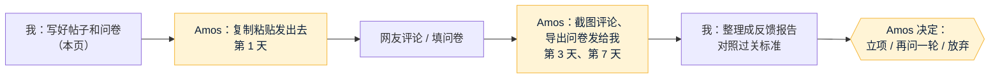

# 发帖包：狗狗鲜食营养的需求验证（第 1 轮）

- 日期：2026-11-04 · 角色：市场经理 · 依据 agents main `e06426e` · 上一份：`01-dog-fresh-food-nutrition.md` 第六节（Amos 11/4「我接受你们的建议」）
- **谁来发**：Amos 用自己的账号发（底线 2：对外发布由 Amos 执行）。我只写草稿、整理反馈，**不注册账号、不登录、不替你回复**。
- **要验证的两个问题**：①你家狗的情况代表多少人？②别人愿不愿意为“配方 + 营养补充包”付钱？
- **过关标准（事先写好，不事后改）**：收到 **≥ 10 份**有效回答（养狗、并且自己做过狗饭）；其中 **≥ 4 人**担心营养不够，**≥ 2 人**愿意每月付 60 元以上。没到 10 份就继续收，不提前下结论。

## 一图看懂

---

## 一、你要做的（按顺序，全程用手机就行）

**第 1 天（约 20 分钟）**
1. 打开 **腾讯问卷**（微信里搜“腾讯问卷”小程序，免费）→ 新建问卷 → 选“空白问卷”→ 把**第四节**的题目一题一题粘进去 → 发布 → 复制问卷链接。
2. **小红书**：发**帖子 A**（第二节）。小红书帖子里**不要放问卷链接或二维码**，会被限流（这是平台常见规则，我没实测，标“线索”）。有人在评论区回复时，按第五节的追问模板接着问。
3. **微信**：把**帖子 B** 连同问卷链接发到你在的狗友群、小区宠物群和朋友圈。
4. （可选）**豆瓣**“自制狗饭”相关小组，或者**知乎**：发**帖子 C**。

**第 3 天、第 7 天（每次约 5 分钟）**
5. 小红书评论区：**截图**发给我（别人的头像、昵称可以不遮，我整理时不记录任何昵称）。
6. 腾讯问卷：在“数据”页面点“下载数据”（Excel），把文件发给我；不方便的话截图统计页也可以。
7. 微信群里有人私聊你或在群里回答的，同样截图发给我。

> 发帖时用你自己的真实经历，别说成别人的故事。帖子里也别提“我们在做产品”，现在什么都没做出来，提了就是误导，还会让大家回答得不真实。

---

## 二、帖子 A：小红书（主帖）

**标题**（20 字以内，选一个）：
- 狗子不吃狗粮，我开始天天给它做饭了
- 给狗做鲜食的姐妹们，营养你们怎么配的？

**封面**：拍你给狗做的那碗饭，或者狗对着狗粮“嫌弃”的样子。真实照片最好，不要用网图。

**正文**：
> 我家狗最近死活不吃狗粮，换了好几个牌子都不行😮‍💨
> 没办法，现在每天给它做鲜食：鸡胸肉、牛肉、米饭、胡萝卜、南瓜轮着来，它吃得特别香。
>
> 但我越来越心虚：**这样吃营养到底够不够？**
> 查了一下，国外有研究说主人自己做的狗饭，**九成以上都缺营养**，最常缺的是钙😱
>
> 想问问也在给狗做饭的朋友：
> 1️⃣ 你们是怎么配营养的？照着食谱做，还是凭感觉？
> 2️⃣ 会额外加钙粉、维生素吗？加的哪种？
> 3️⃣ 有没有找兽医或营养师算过？
> 4️⃣ 最头疼的是什么？
>
> 评论区交流一下🙏 有靠谱的方法我整理出来分享给大家

**话题标签**：#狗狗鲜食 #自制狗饭 #狗狗挑食 #养狗经验 #狗狗营养

**我这样写的理由**：用自己的真实问题开头，大家愿意回；结尾承诺把结果分享出来，回的人更多（推断）。这里的“九成以上”来自上一份调研第二节（证实）。

---

## 三、帖子 B：微信群 / 朋友圈（带问卷链接）

> 请教一下群里给狗做饭的朋友🐶 我家狗不吃狗粮，最近天天给它做鲜食，但不知道营养配得对不对。
> 做了个 1 分钟的小问卷，想看看大家都是怎么做的，**填完我把汇总结果发回群里**，大家一起参考🙏
> 【粘贴问卷链接】

## 帖子 C：豆瓣小组 / 知乎（长一点，适合讨论）

**标题**：给狗做鲜食的人，你们怎么确定营养够不够？
**正文**：用帖子 A 的正文，去掉表情符号；结尾加一句：“我也做了个小问卷，想把大家的做法汇总一下，回复我就私信发你链接。”（豆瓣、知乎直接贴外链容易被删，这是线索，未实测。）

---

## 四、问卷题目（粘进腾讯问卷，共 10 题，约 1 分钟）

**问卷标题**：给狗狗做饭的朋友，你们都是怎么做的？
**开头说明**：匿名，1 分钟。填完我会把汇总结果分享出来。

1. 你现在怎么喂狗？（单选）
   ○ 只吃狗粮　○ 狗粮为主，偶尔加自己做的　○ 一半一半　○ 主要吃自己做的　○ 主要吃买的成品鲜食
   → 选“只吃狗粮”的跳到第 9 题
2. 你为什么开始给狗做饭？（多选）
   □ 狗不爱吃狗粮　□ 觉得更健康　□ 狗有肠胃 / 皮肤 / 过敏问题　□ 兽医建议　□ 不放心狗粮质量　□ 其他____
3. 给狗做饭多久了？（单选）
   ○ 不到 1 个月　○ 1～6 个月　○ 6 个月～1 年　○ 1 年以上
4. 你的狗饭是怎么配的？（单选）
   ○ 凭感觉　○ 照网上 / 小红书的食谱　○ 照书上的食谱　○ 兽医或营养师给的食谱　○ 用 App 或软件算的
5. 会额外加营养补充剂吗？（多选）
   □ 不加　□ 钙粉 / 骨粉　□ 复合维生素　□ 鱼油　□ 卵磷脂　□ 其他____
6. 你担心狗饭的营养不够吗？（单选）
   ○ 完全不担心　○ 有点担心　○ 很担心　○ 不知道该不该担心
7. 给狗做饭，最头疼的是什么？（多选，最多 3 个）
   □ 不知道营养配得对不对　□ 不知道每天该喂多少　□ 太花时间　□ 食材成本高　□ 不知道哪些东西狗不能吃　□ 狗吃腻了又挑食　□ 其他____
8. 如果有一个服务：**输入你家狗的体重、年龄和你想用的食材，就给出每天各放多少克；再每月寄一包配好的营养补充粉，拌进饭里就能补齐营养**。你每月最多愿意付多少？（单选）
   ○ 不需要　○ 30 元以内　○ 30～60 元　○ 60～100 元　○ 100～150 元　○ 150 元以上
9. 你家狗多大、多重？（填空，例如：3 岁 / 8 公斤）
10. 愿意的话，留个微信，有结果时我发你一份汇总（选填）

> 第 8 题是过关标准里“愿意付 60 元以上”的依据。第 10 题留下的联系方式，**只由你保存、只用于发汇总**，我整理时不会写进任何文件。

---

## 五、评论区追问模板（你看情况复制）

- 有人说“凭感觉做”：
  > 我也是😂 你家狗吃多久了？体检有没有查出什么问题？
- 有人说“加了钙粉 / 维生素”：
  > 请问加的哪个牌子？每天加多少，是怎么算出来的？
- 有人说“找过营养师 / 兽医”：
  > 方便说一下大概多少钱、在哪找的吗？后来一直照着做了吗？
- 有人说“太麻烦，后来不做了”：
  > 是哪一步最麻烦？如果有人帮你算好配方、寄好补充粉，你还会做吗？
- 有人推荐某个食谱或产品：
  > 谢谢！你自己用了多久，效果怎么样？

**别做的事**：别推销、别说“我们在做一个产品”、别私信没回复过你的人。

---

## 六、我收到反馈后交给你什么

- **第 3 天**：一页简报：多少人回了、大家最常说的 3 个痛点、几条有代表性的原话（不写昵称）。
- **第 7 天**：完整的反馈报告：逐条对照过关标准（10 份 / 4 人担心 / 2 人愿意付 60 元以上），给出建议“立项 / 再问一轮 / 放弃”，交给你在关卡上决定。
- 数字一律只按你发来的截图和导出文件统计，**看不到的不估**（底线 3）。

---

## 七、决定记录
- 2026-11-04 Amos：「我接受你们的建议，但是作为公司成员，我希望你们可以去发帖子并收集反馈给我看」→ 我说明了不能代发的原因（底线 1、forecast 授权清单“永远不自动”那一条），改为我写草稿、Amos 发。
- 2026-11-04 Amos：「都有，按建议」→ 小红书账号和狗友群都有；按本页第一节执行。第 1 天 = 11/4，第 3 天回收 = 11/7，第 7 天出完整报告 = 11/11。
