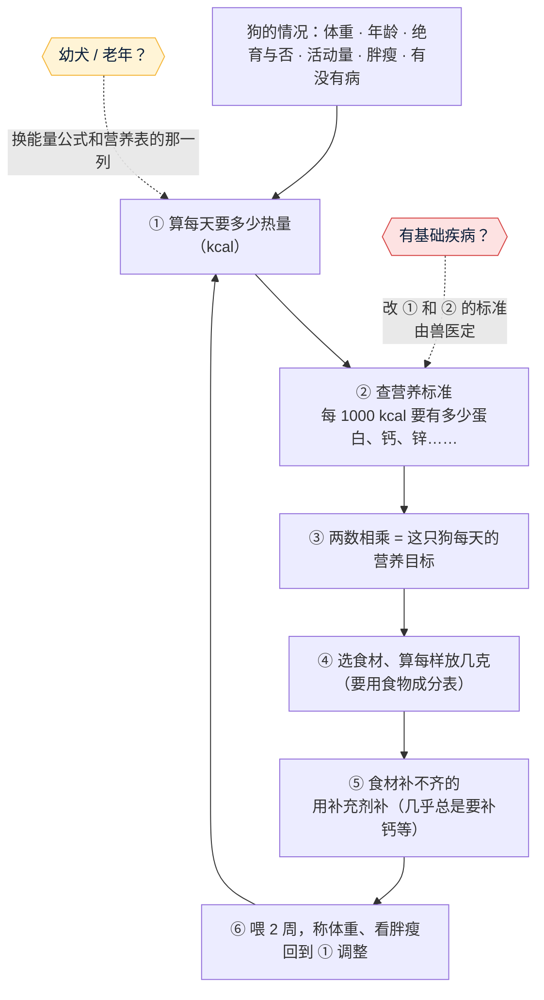

# 狗狗鲜食的营养配比：怎么做、怎么算、年龄和疾病有什么不同

- 日期：2026-11-04 · 角色：市场经理（调研），内容偏技术，后面交研发、产品参考 · 依据 agents main `e06426e`
- 起因：Amos 11/4「你们先研究一下宠物鲜食的营养配比，是怎么做的？是怎么算的？包括年龄的大小和是否有基础疾病，是否会有不同。」
- **采集范围**：7 次网页搜索；**打开原文核对了 4 份**：①FEDIAF 2024 营养指南 PDF（98 页，第 15 页狗营养表、第 54～55 页能量表，原文逐行看过）；②美国宠物营养联盟（PNA）能量系数表 PDF；③Tufts 大学兽医营养专科医师 Heinze 写的肾病饮食文章（dvm360）；④Today's Veterinary Practice 的肾病饮食文章。打不开的：AAHA 2021 营养指南（403）、美国农业部食物成分数据库（接口被限流）。**每种食材含多少营养这一层，本报告没有核对数据**，第四节会说明。
- 标注口径（C66）：**证实** = 打开原文核对过；**线索** = 只看到摘要或二手资料；**推断** = 我按写明的方法算的或判断的。
- ⚠️ 这是帮你看懂“怎么算”的调研，**不是给某一只狗的处方**。有病的狗一定要兽医定方案。

## 一图看懂

**一句话**：营养配比是一道**“先算热量，再按热量配营养”**的数学题。标准是公开的（欧洲 FEDIAF、美国 AAFCO），所以健康狗的计算**可以做成工具自动算**。年龄不同，换的是公式和标准表里的那一列；有基础疾病时，标准本身就变了，**必须由兽医定**。

---

## 一、怎么算（健康成年狗）

### 第 1 步：算每天要多少热量
| 内容 | 看到的（出处） | 标注 |
|---|---|---|
| **静息能量 RER = 70 × 体重(kg)^0.75**（kcal/天） | PNA 能量表 | **证实** |
| 每天实际要的热量 **MER = 系数 × RER**：绝育成年犬 1.6；未绝育成年犬 1.8；容易胖或活动少 1.2～1.4；减肥 1.0；幼犬 2～3（越小越高，约 4 月龄后开始下降）；怀孕 1.6～2.0；哺乳 2～6 | PNA 能量表 | **证实** |
| 这些公式**只是起点**，个体差异最多能到 **±50%**，要按胖瘦调整 | PNA 原文 | **证实** |
| 欧洲标准按年龄给的值：1～2 岁 130、3～7 岁 110、7 岁以上 95 kcal × 体重^0.75 | FEDIAF 2024 表 VII-6 | **证实** |
| 理想胖瘦是 9 分制的 4～5 分 | FEDIAF 2024 | **证实** |

**例子**（推断，按上面的公式算）：10 kg、绝育、4 岁的狗
- RER = 70 × 10^0.75 ≈ **394 kcal**
- MER = 1.6 × 394 ≈ **630 kcal/天**（按 FEDIAF 3～7 岁算是 619 kcal，两种算法基本一致）

### 第 2 步：查营养标准（每 1000 kcal 要有多少）
营养标准**按每 1000 kcal 写**，不按每 100 克写，因为狗吃多少是由热量决定的。下表是 FEDIAF 2024 成年狗那一列（按每天 110 kcal/kg^0.75 计），摘了最容易缺的几项：

| 营养素 | 成年狗最低（每 1000 kcal） | 上限 | 标注 |
|---|---|---|---|
| 蛋白质 | 45 g | — | **证实** |
| 脂肪 | 13.75 g | — | **证实** |
| 钙 | 1.25 g | 6.25 g | **证实** |
| 磷 | 1.00 g | 4.00 g | **证实** |
| 钙磷比 | 至少 1:1 | 最高 2:1 | **证实** |
| 锌 | 18 mg | 欧盟法定上限 | **证实** |
| 铜 | 1.8 mg | 欧盟法定上限 | **证实** |
| 碘 | 0.26 mg | 欧盟法定上限 | **证实** |
| 维生素 D | 138 IU | 800 IU | **证实** |
| 维生素 E | 9 IU | — | **证实** |
| 胆碱 | 409 mg | — | **证实** |

（出处：FEDIAF 2024 第 15 页表 III-3b。表里一共 40 多项，这里只列最常缺和上限要紧的。）

### 第 3 步：热量 × 标准 = 这只狗每天的营养目标
继续上面那只 10 kg 的狗，每天 630 kcal（推断，按上表相乘）：

| 蛋白质 | 脂肪 | 钙 | 磷 | 锌 | 维生素 D | 胆碱 |
|---|---|---|---|---|---|---|
| ≥ 28.4 g | ≥ 8.7 g | ≥ 0.79 g | ≥ 0.63 g | ≥ 11.3 mg | ≥ 87 IU | ≥ 258 mg |

### 第 4 步：选食材、算每样放几克
- 要知道每种食材每 100 克含多少热量、蛋白、钙、锌……（**食物成分表**：中国有《中国食物成分表》，美国有农业部的 FoodData Central）。
- 然后解一道题：**怎么搭配，才能让热量刚好、每一项营养都在最低值和上限之间**。这在数学上叫“线性规划”，Balance It 这类配方软件做的就是这件事（推断：从它的工作方式推出来的，没看到它公开的算法）。
- 本报告**没有核对每种食材的成分数据**，所以不在这里给具体克数，免得给出错的配方。

### 第 5 步：补缺口
- 只用肉、菜、饭，几乎一定补不齐钙，常常还缺锌、维生素 D、维生素 E、胆碱、碘（上一份调研第二节：94%～95% 的自制饭或食谱不合格，证实；具体缺哪几项是线索）。
- 所以**配方 = 食材 + 一份配好的补充剂**。这正是上一份调研里说的“营养补充包”生意的来源。

### 第 6 步：喂、称、调
每 2 周称一次体重、看胖瘦（4～5 分为理想），胖了减热量、瘦了加热量，再回到第 1 步（推断，依据是 PNA 说的“±50%，只是起点”）。

---

## 二、年龄不同，算法有什么不同

| 阶段 | 热量怎么算 | 营养标准有什么变化 | 标注 |
|---|---|---|---|
| **幼犬（8 周～1 岁）** | 用专门的公式：**(254.1 − 135 × 现体重 / 预计成年体重) × 现体重^0.75**。离成年体重越远，每公斤要的热量越多 | 蛋白、钙、磷都更高：**14 周以前**每 1000 kcal 蛋白 62.5 g、钙 2.5 g、磷 2.25 g；**14 周以后**蛋白 50 g、钙 2.0～2.5 g、磷 1.75 g；钙有上限（早期 4.0 g，后期 4.5 g） | **证实**（FEDIAF 第 15、55 页） |
| **大型犬幼犬**（成年体重超过 15 kg） | 同上 | 到约 **6 月龄**前钙要保持 2.5 g/1000 kcal，钙磷比最高 **1.6:1**；6 月龄后才能降到 2 g、比例放宽到 1.8:1 | **证实**（FEDIAF 脚注 b） |
| 幼犬共通 | **不能让它敞开吃**，吃太多会长得太快，大型犬容易骨骼变形 | 钙**太多**和太少一样有害，大型犬幼犬吃完整的狗粮时**不要再额外加钙** | 不能敞开吃：**证实**（FEDIAF）；不加钙：线索 |
| **1～2 岁** | 130 kcal × 体重^0.75 | 用成年标准 | **证实** |
| **3～7 岁** | 110 kcal × 体重^0.75 | 用上面第 2 步那张表 | **证实** |
| **7 岁以上（老年）** | **95 kcal × 体重^0.75**（范围 80～120），吃得更少 | 用 FEDIAF“95 kcal”那一列：**每 1000 kcal 的营养要更浓**（例如蛋白 52.1 g、钙 1.45 g、锌 20.8 mg），因为吃得少，但每天需要的营养总量差不多；FEDIAF 的蛋白标准本身已经考虑了老年狗的需要 | **证实** |
| 老年狗还要看肌肉 | — | 要同时看胖瘦和肌肉，老年狗可能体重正常但肌肉在流失 | 线索（WSAVA 相关资料，没打开原文） |
| 怀孕 / 哺乳 | 怀孕前 4 周 132 kcal × 体重^0.75，后 5 周再加 26 kcal × 体重；哺乳按窝仔数另算 | 用“生长与繁殖”那一列 | **证实**（FEDIAF） |

**同样是“10 kg 的狗”，差别有多大**（推断，按上表算）：
- **4 岁、绝育**：约 630 kcal/天，钙 ≥ 0.79 g
- **8 岁老年**：约 534 kcal/天（少 15%），但钙仍要 ≥ 0.77 g、蛋白 ≥ 27.8 g，几乎没少 → **饭量少了，营养却不能少，配方要更浓**
- **16 周的幼犬**（成年预计 10 kg，现在约 5.4 kg）：约 **642 kcal/天**，比成年狗还多；钙 ≥ 1.6 g，**是成年狗的 2 倍**

---

## 三、有基础疾病时有什么不同

**最重要的一句**：有病的狗，**标准本身就改了**，而且两种病的要求可能互相冲突。这部分**只能由兽医（最好是兽医营养专科医师）定**，工具只能提醒，不能代算。

| 疾病 | 饮食上主要改什么 | 标注 |
|---|---|---|
| **慢性肾病** | ①**限磷是最关键的一条**；②早期（IRIS 1 期、没有蛋白尿）可以先选磷低于 **1.5 g/1000 kcal**、蛋白适中的饮食；③**3 期或有蛋白尿，大多数只应吃商业处方肾病粮**；④蛋白要不要限争议很大，没有公认的数值；⑤补 Omega-3（EPA + DHA） | **证实**（Heinze，Tufts 兽医营养专科医师，dvm360） |
| 肾病（补充） | 有研究用每 1000 kcal 蛋白 35 g、磷 750 mg；蛋白低到 17 g 反而有害；Omega-3 建议 EPA 40 mg/kg + DHA 25 mg/kg 体重/天；有的狗血钾高，要专门配低钾的自制饭 | **证实**（Today's Veterinary Practice） |
| **胰腺炎** | 低脂：常见建议是脂肪低于 **30 g/1000 kcal**，严重或反复的更低（20～25 g）；以空腹血脂和不再复发为准，个体差异大 | 线索（二手资料，没打开原始文献） |
| **肾病 + 胰腺炎** | 互相冲突：肾病粮常常偏油，胰腺炎要低脂，往往只能**请营养专科医师定制自制饭** | 线索（dvm360 另一篇的摘要） |
| **肥胖** | 热量按 **1.0 × RER**；理想体重怎么定、减多快，由兽医定 | 系数：**证实**（PNA）；其他：推断 |
| **糖尿病** | 高纤维（可溶 + 不可溶）、蛋白偏高（没有禁忌时）；**最重要的是吃饭时间、饭量和打胰岛素的时间固定** | 线索（AAHA 2021 摘要，原文 403 打不开） |
| **食物过敏** | 用“没吃过的蛋白”或水解蛋白，做 8 周左右的排除试验（周数是行业常识，没核对） | 线索 |
| **尿结石** | **先查清是哪种结石**：鸟粪石和草酸钙的饮食方向相反，搞错会更严重 | 线索 |
| 心脏病、肝病 | 一般涉及钠（心脏）、铜和蛋白（肝），这次没查 | **未查到** |

---

## 四、对“产品”意味着什么（全是推断，给 Amos 和研发参考）

1. **健康狗的配比可以自动算**：第一节第 1～3 步全是公开公式 + 公开标准表（FEDIAF 2024 免费下载），没有门槛。
2. **真正的难点在第 4、5 步**：①要一份可靠、可以合法使用的中国食材成分数据（《中国食物成分表》能不能商用，**未查到**）；②要设计一份通用的补充剂配方，并且能被验证（最好送检）。
3. **疾病是产品的边界**：有病的狗一律提示“请找兽医”，或者转给合作的兽医营养师，**不自动出配方**。这样风险最低，也是“兽医营养师背书”的切入点。
4. **年龄是必填项**：幼犬，尤其是大型犬幼犬，钙出错的后果最严重，工具里要单独做强提醒。

## 五、你家小狗：可以先帮你算目标

你把下面 6 项告诉我，我就按第一、二节帮它算出**每天要多少热量、每样营养至少要多少**（只给目标，不给具体配方）：
1. 体重（kg）　2. 年龄　3. 公 / 母，绝育没有　4. 每天大概运动多久　5. 胖瘦（摸肋骨：很容易摸到 / 稍微用力能摸到 / 摸不到）　6. 有没有已知的病，或者在吃什么药

---

## 来源（实际打开过的标 ✅）
- ✅ [FEDIAF Nutritional Guidelines 2024（PDF）](https://europeanpetfood.org/wp-content/uploads/2024/09/FEDIAF-Nutritional-Guidelines_2024.pdf)：第 15 页表 III-3b、脚注 a～c；第 54～55 页表 VII-6、VII-8a、VII-8b
- ✅ [Pet Nutrition Alliance：Calculating Calories Based on Pet Needs（PDF）](https://petnutritionalliance.org/wp-content/uploads/2023/03/MER.RER_.PNA_.pdf)
- ✅ [dvm360，Heinze：Renal diets for veterinary patients](https://dvm360.com/view/renal-diets-veterinary-patients-what-feed-and-when-start)
- ✅ [Today's Veterinary Practice：Diet for dogs with CKD](https://todaysveterinarypractice.com/nutrition/diet-dogs-ckd-chronic-kidney-disease/)
- 线索：[AAHA 2021 营养与体重管理指南：治疗性饮食](https://www.aaha.org/resources/2021-aaha-nutrition-and-weight-management-guidelines/use-of-therapeutic-diets-not-related-to-weight-loss/)（403）、[胰腺炎低脂（二手）](https://hs4dfinal.squarespace.com/pancreatitis)、[Whole Dog Journal 低脂饮食](https://www.whole-dog-journal.com/health/weight_control/healthy-low-fat-diets-for-dogs-with-special-dietary-needs/comment-page-1/)、[dvm360 幼犬喂养](https://www.dvm360.com/view/feeding-growing-puppies-proceedings)、[VCA 大型犬](https://vcahospitals.com/know-your-pet/giant-breed-dogs)、[WSAVA 营养指南](https://wsava.org/global-guidelines/global-nutrition-guidelines/)、[dvm360 体况与肌肉评分](https://dvm360.com/view/understanding-body-and-muscle-condition-scoring)
