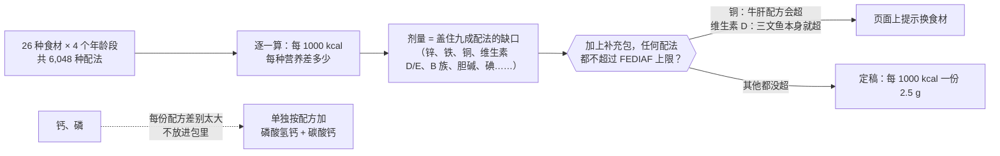

# 补充包配方（草案 v0.1）：给自制狗饭补齐营养

- 日期：2026-11-04 · 角色：产品 + 研发（配方计算） · 依据 agents main `e06426e` · 上一份：`03-鲜食营养配比怎么算.md`
- 起因：Amos 11/4「把缺的营养做成补充包配方」
- ⚠️ **这是计算出来的草案，不能直接生产或卖。** 做成实物前必须：①兽医营养师审核；②工厂按饲料级工艺生产，并送检；③查清在中国作为宠物饲料添加剂销售要办的资质（**未查到**，下一步要单独调研）。

## 一图看懂

## 一、怎么定的剂量（实际执行，不是估计）
1. 用 demo 里的配方算法，把 **20 种肉、主食、蔬菜 × 3 种内脏选择（不加 / 鸡肝 / 牛肝）× 加不加鸡蛋 × 4 只示例狗**（成年 10 kg、老年 8 岁、幼犬 16 周、幼犬 10 周）全部跑一遍，共 **6,048 种配法**。
2. 每种配法先按 demo 的规则补好钙、磷，再统计每 1000 kcal 每种营养还差多少。
3. 补充包的剂量 ≈ **九成配法的缺口再多一点**。
4. 加上补充包后重跑一遍，查有没有超过 FEDIAF 2024 的上限（法定上限按 FEDIAF 的换算：每 100 g 干物质 × 2.5 = 每 1000 kcal，证实）。

**结果**（加补充包后，还不够的配法占比）：

| 营养 | 不加补充包 | 加补充包 |
|---|---|---|
| 锌 | 100% | 1% |
| 维生素 E | 81% | 4% |
| 铁 | 79% | 7% |
| 维生素 D | 77% | 6% |
| 铜 | 67% | 18%（主要是幼犬：加鸡肝就够） |
| 胆碱 | 51% | 1% |
| 维生素 B2 | 47% | 1% |
| 维生素 B12 | 41% | 3% |
| 碘 | 全部（食材数据库里没有碘的数据） | 0%（只算了补充包） |
| α-亚麻酸 | 23% | 23%（靠选油解决：用大豆油） |

**会超上限的**：①用**牛肝**当内脏时，铜会超（10 种配法）；②用**三文鱼**当主肉时，维生素 D 本身就超（12 种配法，和补充包无关）。demo 里这两种情况会标红，并提示换食材。

## 二、配方：每份（= 每 1000 kcal）2.5 g

| 原料（饲料级） | 补什么 | 每份提供 | 原料用量 | 含量怎么来的 |
|---|---|---|---|---|
| 氯化钠（食盐） | 氯、钠 | 氯 0.58 g、钠 0.37 g | 953 mg | 化学式：氯 60.7%、钠 39.3% |
| 氯化钾 | 钾、氯 | 钾 0.30 g、氯 0.27 g | 572 mg | 化学式：钾 52.4% |
| 氯化胆碱粉（60%） | 胆碱 | 220 mg | 491 mg | 化学式 × 60%：胆碱 44.8%；规格是常见商品规格（线索） |
| 氧化镁 | 镁 | 60 mg | 99.5 mg | 化学式：镁 60.3% |
| 硫酸锌（一水） | 锌 | 22 mg | 60.4 mg | 化学式：锌 36.4% |
| 硫酸亚铁（一水） | 铁 | 16 mg | 48.7 mg | 化学式：铁 32.9% |
| 维生素 E 粉（醋酸酯 50%，500 IU/g） | 维生素 E | 10 IU | 20.0 mg | 常见商品规格（线索） |
| 硫酸铜（五水） | 铜 | 2.0 mg | 7.9 mg | 化学式：铜 25.5% |
| 亚硒酸钠预混料（1%） | 硒 | 15 µg | 3.3 mg | 化学式：硒 45.7%，先稀释成 1% |
| 硫酸锰（一水） | 锰 | 1.0 mg | 3.1 mg | 化学式：锰 32.5% |
| D-泛酸钙 | 泛酸 | 2.0 mg | 2.2 mg | 化学式：泛酸 92.0% |
| 核黄素 | 维生素 B2 | 1.2 mg | 1.2 mg | — |
| 维生素 B12 粉（1%） | 维生素 B12 | 8 µg | 0.8 mg | 常见商品规格（线索） |
| 碘酸钾 | 碘 | 0.40 mg | 0.67 mg | 化学式：碘 59.3% |
| 维生素 D3 粉（50 万 IU/g） | 维生素 D | 140 IU | 0.28 mg | 常见商品规格（线索） |
| 硝酸硫胺 | 维生素 B1 | 0.2 mg | 0.25 mg | 化学式：硫胺素 81.1% |
| 叶酸 | 叶酸 | 20 µg | 0.02 mg | — |
| 麦芽糊精（载体） | 补足重量 | — | 约 235 mg | — |
| **合计** | | | **2,500 mg** | |

**怎么用**：每天的份数 = 这只狗每天的热量 ÷ 1000。例如 630 kcal/天的狗，每天 0.63 份 ≈ 1.6 g，拌进饭里。

**为什么不放钙、磷**：钙和磷的需要量取决于这份饭里本来有多少磷，不同配方差别很大（demo 里每天要的磷酸氢钙从 0 到几克都有），放进固定剂量的包里，要么不够，要么钙磷比失调。所以单独做成“钙磷粉”，按 demo 算的量加。

**为什么不放维生素 A**：用了内脏和橙色蔬菜的配方基本都够；动物来源的维生素 A 过量有毒，所以不放。

## 三、几个关键判断（推断，给 Amos 定方向）
1. **这个包只能工厂做，不能让用户自己配**：表里有 7 种原料每份不到 1 mg（例如维生素 D3 0.28 mg、叶酸 0.02 mg），家用秤根本称不了，必须用工厂的预混工艺逐级稀释。
2. **“一份 = 1000 kcal”很好用**：营养标准本来就按热量写，所以不管狗多大，用户只要知道每天热量（demo 会算），就知道放几份。
3. **成本**：原料都是常见的饲料级大宗原料，单份原料成本应该很低（**未查价**，下一步找 2～3 家预混料工厂询价）。

## 四、局限
- 食材营养用的是美国农业部数据，没有用中国数据；数据库没有记录的营养按 0 算，所以缺口算得偏大（保守）。
- 没有考虑原料之间的相互作用、吸收率和储存时的维生素损失（工厂一般会按损失多加一些，这里没加）。
- 没有覆盖疾病狗、怀孕和哺乳的狗。

## 五、下一步
1. 等 11/7、11/11 收到需求验证的反馈，再决定要不要往实物推进。
2. 如果推进：①找兽医营养师审核本配方；②调研宠物饲料添加剂的资质（L3 前置）；③找预混料工厂询价、打样、送检（会花钱，要 Amos 先批，底线 8）。
