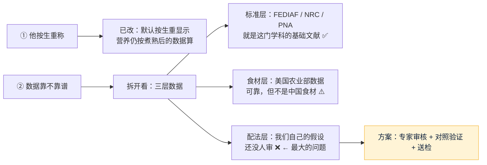

# 朋友试用反馈：①为什么按熟重　②数据靠不靠谱

- 日期：2026-11-04 · 角色：产品（问题分析）+ 研发（改 demo） · 依据 agents main `e06426e`
- 来源：Amos 转述朋友的两个问题：「为什么这个 demo 使用了熟食的标准而不是生食，他做饭时称重的是生食」；「他开始质疑我们产出的数据是否靠谱，所以他推荐我去看宠物营养学」（Amos 补充：「宠物营养学是一门学科，不是一本书」）

## 一图看懂

## 一、生重：已经改好（实际执行）
- **原因**：美国农业部的食材数据有生、熟两组，我选了熟的，因为煮熟以后的营养（已经扣掉烹饪损失）才是狗真正吃到的。但没有考虑到大家做饭都是下锅前称重。
- **改法**：营养**仍按熟的数据算**，只是把克数换算成生重显示，默认就是生重，可以切回熟重。
- **换算系数**：用同一种食材的生、熟两组数据算出来。肉、蛋、内脏按“蛋白质总量不变”换算（例如 1 g 熟鸡胸肉 = 1.38 g 生鸡胸肉）；主食、蔬菜按“热量不变”换算（1 g 米饭 = 0.36 g 生米）。这个方法是推断，做法不同（炖、蒸、炒）会有几个百分点的误差。
- 例子：10 kg 成年狗，**生鸡胸肉 171 g + 生米 100 g + 胡萝卜 27 g + 西兰花 32 g + 葵花籽油 4.1 g**。
- **生食喂养（不煮直接喂）不支持**：生肉有细菌和寄生虫的风险，兽医机构普遍不推荐（线索，这次没核对原文）。页面上的配方都默认做熟喂。

## 二、可信度：朋友说得有道理，但要分层看

| 层 | 用了什么 | 靠谱程度 | 标注 |
|---|---|---|---|
| **标准**（每天要多少营养） | FEDIAF 2024 营养指南（它以美国国家研究委员会 NRC 2006《狗和猫的营养需要》为基础）、PNA 热量公式 | **这就是宠物营养学这门学科的核心参考资料**，行业和兽医都在用 | 原文核对过：**证实** |
| **食材**（每种食材含多少营养） | 美国农业部 FoodData Central | 权威数据库，但是美国食材；中国的肉、米成分会有差别；没有碘的数据 | 证实（数据来源）；差别多大：**未查到** |
| **配法**（每样放多少、补充包剂量） | **我们自己设的比例**：蛋白质占热量 30%、内脏 5%、鸡蛋 10%、蔬菜每 kcal 0.1 g；补充包按 6,048 种配法统计 | 计算本身没错，但**比例是否合理、补充包是否安全，没有任何专家审过** | **推断** |

**结论**：朋友质疑的点是对的，问题出在第三层，“标准”这一层是站得住的。第三层恰恰是我们要卖的东西（配方 + 补充包），所以必须补上。

## 三、方案：分三步提高可信度（前两步不花钱）

| 步骤 | 做什么 | 花钱吗 | 谁做 | 做完能说什么 |
|---|---|---|---|---|
| ① 页面上说清楚（**已做**） | 页面加了“这些数字靠不靠谱？”一节：哪些来自权威标准、哪些是我们的假设、哪些还没做 | 不花 | 我 | “我们不藏着” |
| ② 对照验证 | 找已发表的、由兽医营养专科医师写的自制食谱（例如 2013 年 UC Davis 研究里那 4 份合格食谱，或兽医营养学教材里的示例），用 demo 的算法算一遍，看结果和原作者是否一致；同时把 FEDIAF 和美国 AAFCO 的标准对照一遍 | 不花 | 我 | “和专家配方的结果一致 / 差在哪” |
| ③ 专家审核 | 请 1 位兽医营养专科医师（美国 ACVN、欧洲 ECVCN 认证）或国内高校动物营养方向的老师，审核配法假设和补充包配方 | **要花钱**（美国一次咨询 50～500 美元，见调研 01；国内价格未查到） | Amos 决定（底线 8） | “经兽医营养师审核” |
| ④ 送检（以后） | 按 demo 配一份饭送检测机构，测实际营养含量 | 要花钱 | Amos 决定 | “实测验证” |

**建议**：①已经做了，②我接着做（不花钱，大约 1 个工作块）。③要等 11/11 需求验证的结果：如果需求成立就请专家；不成立就不用花这笔钱。

## 四、给朋友的回复（草稿，Amos 自己发）
> 谢谢指出！两个问题：
> 1. 生重：已经改了，现在默认按下锅前的生重显示，你再打开看看。
> 2. 数据：营养标准用的是欧洲 FEDIAF 2024（它以美国 NRC 2006《狗和猫的营养需要》为基础），食材数据用的是美国农业部的，这两块是宠物营养学里通用的权威资料。但“每样放多少”的比例和补充包是我们自己算的，还没请兽医营养师审，所以现在只是演示版，不能当处方。页面最下面“这些数字靠不靠谱？”里写清楚了。你要是认识做宠物营养的老师或兽医，特别欢迎帮我们看一眼。
